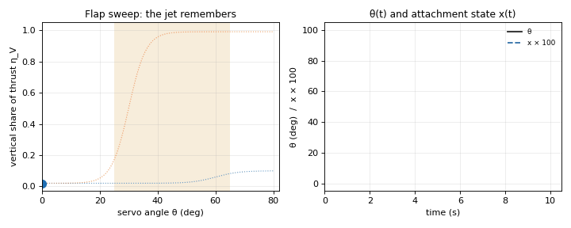
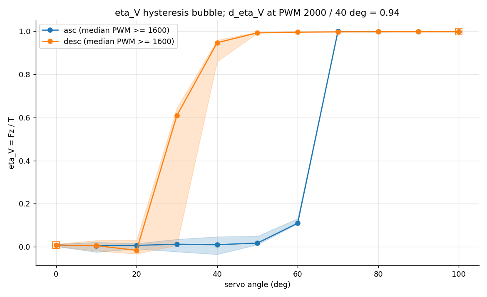
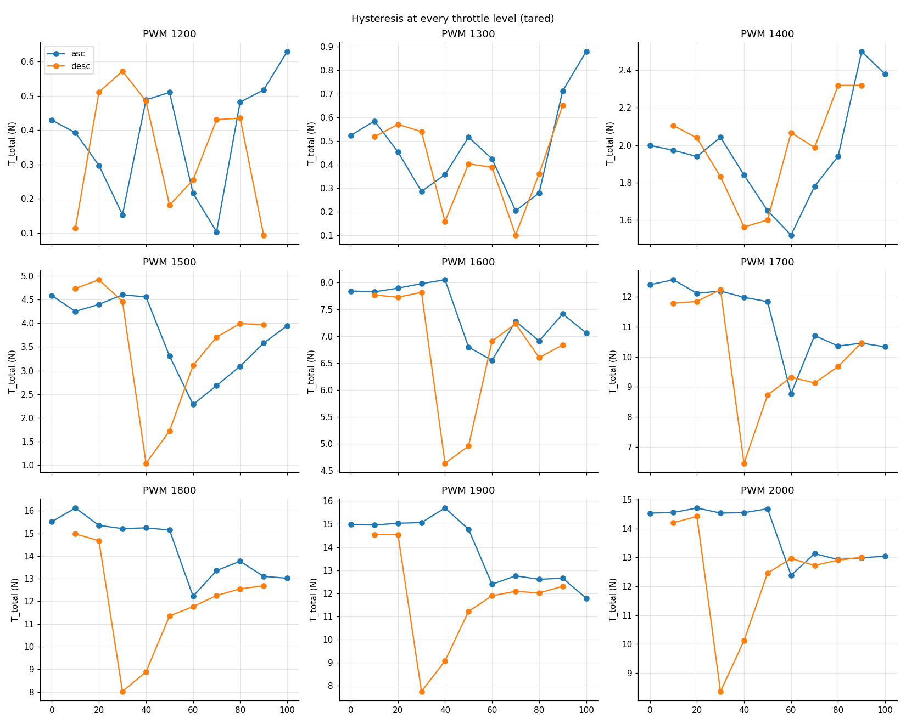
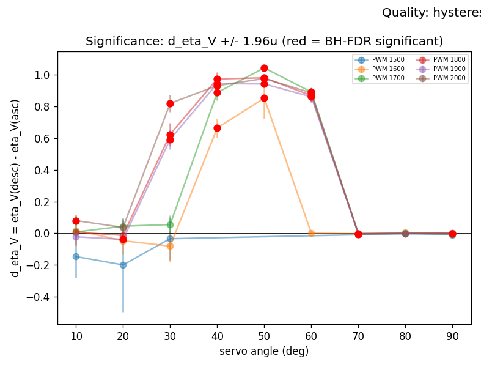
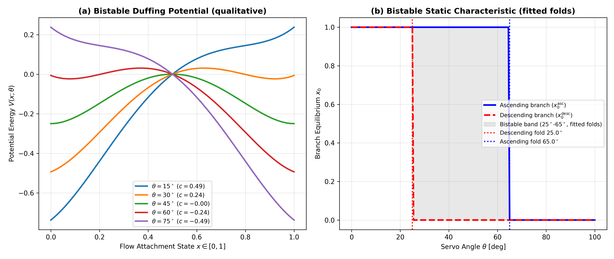
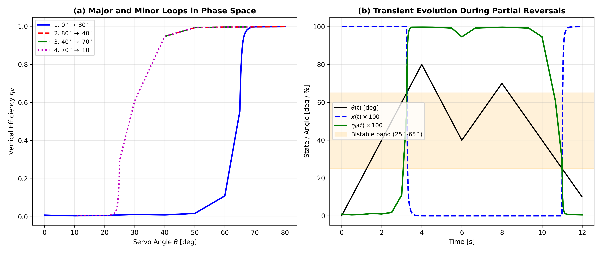
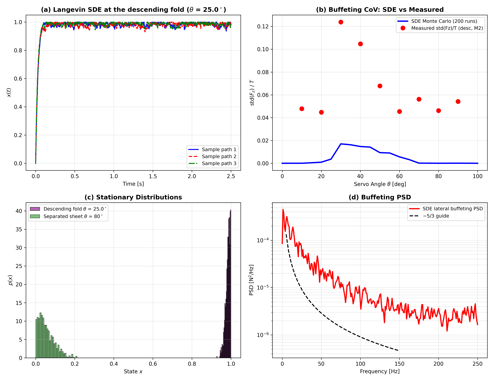
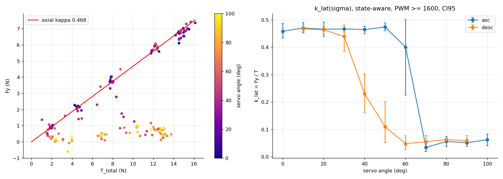
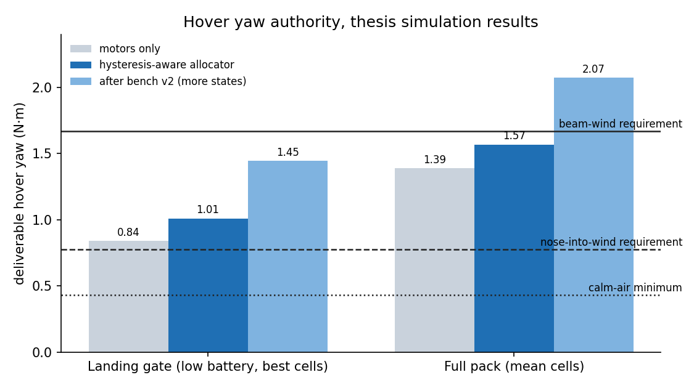

# Thrust Vectoring Hysteresis

**Same flap angle. Same throttle. 99% of the thrust points up, or 5% does. It depends on which way the flap was moving.**



[](tests/test_model.py)
[](LICENSE)
[](LICENSE-content)
◈ Full details: M.S. thesis, Tennessee Tech (Dec 2026)

This repo shows what I found when I put a thrust-vectoring electric ducted fan (EDF) on a 6-axis force/torque bench, and what that finding does to a flight controller. The bench data and thesis code stay with the thesis. This repo contains the main findings, key figures, and a small demonstration model that captures the key physics.

---

## 1. The textbook model

Point a jet through a vectoring nozzle at angle θ and every textbook, and nearly every control allocator, writes the same thing:

```
T_vertical   = T · cos θ
T_horizontal = T · sin θ
```

One angle, one answer. The controller asks for a force, inverts the trig, and commands an angle. This might work for a simple tilt-rotor mechanism, but what happens when you have a Coanda nozzle?

## 2. What the bench showed

The nozzle has a stationary body and a servo-driven internal flap. I swept the flap up and then back down, at 9 throttle levels and 11 servo angles, and logged 58,828 samples of all six forces and moments.



Look at 40°. Coming down from a full deflection, **98.7%** of the thrust points vertically. Going up from zero, at the same angle and the same throttle, **4.7%** does. Same command, two completely different vehicle behaviors.

This isn't one lucky point. Across all 33 matched (angle, throttle) points, the median gap between the descending and ascending branches is **0.61** of total thrust (61 percentage points), and it peaks at **1.04**. It shows up at every throttle level with enough flow to matter:



And it isn't noise. Inside the band, the gap stays statistically significant at most throttle levels after false-discovery-rate correction (red points):



## 3. Why: the jet remembers

The flap bends the jet by the Coandă effect: a fast jet hugs a curved surface. Once it hugs the flap, it keeps hugging until the flap forces it off. Once it has separated, it stays separated until the flap brings it back. Between those two snap points (about 25° and 65° of servo angle) the flow has **two stable states**, and which one you get depends on history.

A double-well picture makes this concrete. Inside the band there are two valleys. The flow sits in one until the flap tilts the landscape so far that its valley disappears.



## 4. A model with memory

Dynamic-stall researchers solved this kind of problem for wings decades ago. Goman and Khrabrov (1994) gave the flow a hidden **attachment state** `x` that relaxes toward an equilibrium instead of jumping:

```
τ dx/dt + x = x0(θ, x)          x = 1 attached, x = 0 separated
η_V(θ, x)  = x·η_attached(θ) + (1 − x)·η_separated(θ)
```

I applied that idea to the vectoring nozzle. The static characteristic `x0` is bistable: separated above the upper fold, attached below the lower fold, and "stay where you are" in between. That last rule is the memory. It predicts what partial reversals do, including minor loops that return to where they started. (The v1 bench only ran full sweeps; bench v2 tests the reversals.)



**Run it yourself.** `tvh/model.py` is a clean-room version with illustrative curves (not the measured data):

```bash
pip install -r requirements.txt
make figures   # writes figures/demo_minor_loops.png, hysteresis_loop.gif, hover_yaw.png
make test      # 7 tests: bistability, snap-through, direction dependence, return-point memory
```


## 5. Buffeting

Near the folds the jet doesn't sit still. A stochastic (Langevin) term on the state adds buffeting (200 Monte Carlo runs):



Panel (b) is the honest part: the stochastic layer puts the buffeting peak in the right place but underpredicts its size several times over. That's an open item, not a solved one.

## 6. The jet also pushes sideways

The fan's swirl doesn't vanish in the nozzle. With the flow attached, the side force is about **47% of the axial thrust** (κ = 0.468), and it collapses to a few percent once the jet separates onto the flap. The side force has its own hysteresis, too:



A vehicle that ignores this gets a large, state-dependent yaw and roll disturbance for free.

## 7. What it does to a flight controller

If one angle can mean 5% or 99% vertical thrust, an allocator that assumes `cos θ` will command the wrong forces exactly when the flap passes through the band, often during the transition between hover and forward flight.

I designed a **hysteresis-aware control allocator** for a multi-EDF thrust-vectoring VTOL, built on this state model. Its design isn't published here while concept propagation is underway. Here are its results in simulation:



- At the **landing gate** (low battery, the hardest case), it delivers **1.01 N·m** of hover yaw, about **20% more** than the motors alone (0.84 N·m).
- That meets the calm-air minimum (0.43 N·m) and the nose-into-wind requirement (0.78 N·m).
- It does **not** meet the beam-wind requirement (1.67 N·m). The operational answer is to land nose into wind.


## 8. How it was measured

- A 70 mm EDF with a vectoring nozzle on a 6-axis force/torque sensor.
- Throttle stepped through 9 levels, servo angle through 11, in both sweep directions.
- 58,828 samples, lever-arm corrected and tared.
- Test-rig design and baseline EDF performance are published in AIAA papers [10.2514/6.2026-4745](https://doi.org/10.2514/6.2026-4745) and [10.2514/6.2026-4746](https://doi.org/10.2514/6.2026-4746).

*Angles are servo angles, θ ∈ [0°, 100°]. The flap moves through a gear, so the mechanical flap angle is smaller.*

## 9. Status and limits

- The state model is fitted to bench data only. It has no independent validation yet.
- The relaxation time is an upper bound, not a fitted value: the force sensor updates at about 10 Hz, and every v1 angle change was a step. Bench v2 uses multi-rate ramps designed to identify it.
- The buffeting layer underpredicts the measured magnitude (§5).
- The allocator results are simulation results. It hasn't flown.

## 10. Where the full story is

The thesis, *Modelling, Simulation, and Autonomous Control of a Thrust-Vectoring Multi-EDF VTOL UAV* (Tennessee Tech, December 2026), has the fitted constants, the model benchmark and the full derivations. I'll link it here once it's published.

## 11. Cite / contact

See [CITATION.cff](CITATION.cff). Papers are cited as Odukoya, O.

**Dara Odukoya**
[LinkedIn](https://linkedin.com/in/thejamesodukoya) · [GitHub](https://github.com/jamesodukoya) · related: [fidelity-ladder](https://github.com/jamesodukoya/fidelity-ladder) (system identification that doesn't trust R²)

Code is MIT. Text and figures are CC BY 4.0. Every number above is traced in [SOURCES.md](SOURCES.md).
