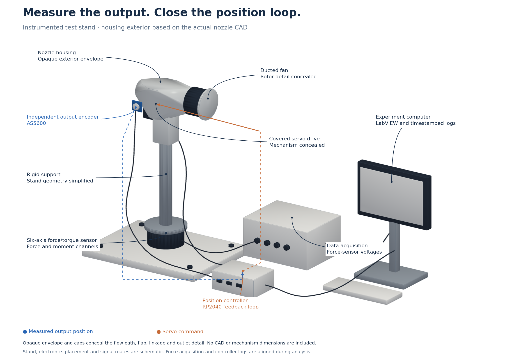
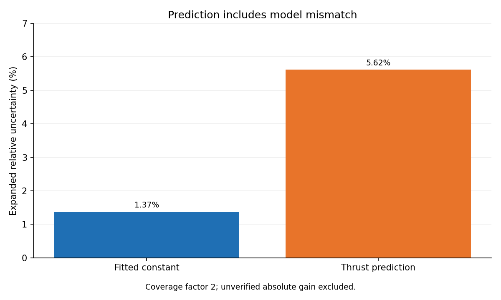
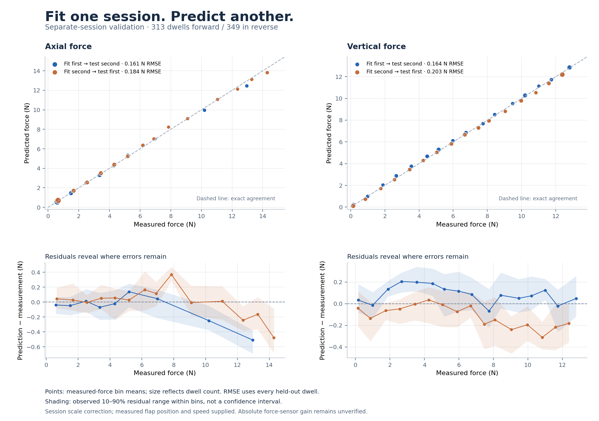
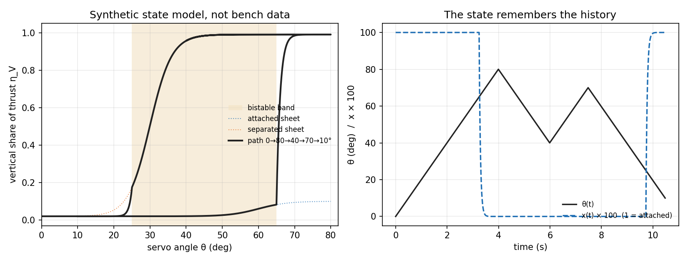

# Actuator characterization: from measurements to a tested force map

**I designed the experiments, corrected the measurement chain, quantified its limits,
and tested force predictions on a separate bench session.**

The actuator was a 70 mm electric ducted fan with a servo-driven internal flap.
The work combined six-axis force/torque sensing, direct flap-position feedback,
motor telemetry, embedded test automation and model validation.

The clearest result: a force map fitted on one session predicted axial and vertical
forces in another at **0.161 and 0.164 N RMSE across 313 held-out dwells**, after
session scale correction. RMSE is the root mean square prediction error, not a
worst-case bound. The reverse session split gave **0.184 and 0.203 N across 349 dwells**.

Those results test a calibrated map using measured position and speed. They do not
establish absolute sensor accuracy or controller performance in flight.

[Result summary](data/characterization_summary.json) · [Sources and qualifications](SOURCES.md)

## The problem that started the investigation

At the same servo command and throttle, the first bench recorded 98.7% of thrust
pointing vertically on the descending sweep and 4.7% on the ascending sweep.
That stand did not measure actual flap position. The result showed that command
alone was insufficient to predict thrust direction; it did not establish the cause.

I followed that observation with direct position sensing, controlled holds,
measurement-chain checks and validation on a separate session. The engineering
contribution is the resulting measurement and modeling method.

## Experiments chosen to answer specific questions



The housing envelope comes from the actual nozzle CAD. The flow path, flap,
linkage and outlet detail are concealed. Stand geometry, electronics placement
and signal routes are schematic; the image contains no CAD or mechanism dimensions.

The five characterization sessions retained **431,591 log rows**, segmented into
**1,642 operating dwells**. A dwell is a period at an operating condition. Repeated
sensor values occur in the logs; these are not 431,591 independent measurements.

| Question | Experiment or check | What it established |
|---|---|---|
| Does the commanded position represent the output position? | Independent flap-shaft encoder and bidirectional command sweeps | Command-to-position calibration and a 5.2° directional gap across the assembled drive; not an isolated measurement of internal servo lash |
| What forces occur at a measured flap position? | Encoder-feedback position holds, ascending and descending staircases across throttle | A map indexed by measured output position, with sweep-direction differences carried as a band |
| Are zero offsets stable during the campaign? | Tares, repeated check conditions and motor-off windows | Observed repeatability and zero drift, distinct from absolute calibration |
| Do controller and force records refer to the same time? | Clock mapping to raw 10 kHz force-sensor voltages | Corrected timestamp joins and explicit remaining timing exceptions |
| Does the map predict another session? | Fit on one re-mounted session, test on the other; reverse the split | Reported force-prediction errors under session scale correction |
| How quickly does thrust respond? | Rotor step tests | Direction-specific time constants and dead times, with two steps per median |

The first instrumented session still used open-loop commands. Later instrumented
sessions used closed-loop position holds. The firmware also supports rate series,
minor loops and thermal soaks, but those blocks were **not run in Chapter 4**.
The session split is an analysis choice, not a claimed pre-registered experiment.

## Corrections that changed which measurements entered the model

**Timing.** Corrupt controller timestamps had been interpreted as reboots, creating
false clock segments. Across three logs, 8,741 powered rows had no joined force
measurement. Repairing the timestamps and rebuilding the joins left no powered
rows without force. Some timing exceptions remain documented in the source record.

**Telemetry freshness.** Repeated values in a fast log do not create new sensor
updates. I used fresh telemetry frames and settled dwell windows, rather than
letting stale readings or row repetition distort operating-point estimates.

**Force versus moment.** I physically re-measured the lever arm and corrected
0.186 m to 0.44 m. Moment-derived axial thrust then agreed with the force channel
within 4% across four stand states. These channels share one sensor, so this is
a consistency check, not an independent absolute calibration.

**Model selection.** I removed a lateral-force term that the moment channels did
not support. The current Chapter 4 model uses a measured flap-position map and a
band for sweep-direction differences. The original command-indexed state model
is not the current force-map validation result.

## Uncertainty in a constant is not uncertainty in a prediction

I combined fit scatter, sensor resolution and zero drift in GUM-style uncertainty
budgets. GUM is the Guide to the Expression of Uncertainty in Measurement.

| Quantity | Expanded relative uncertainty | Interpretation |
|---|---:|---|
| Fitted thrust constant | 1.37% | Quantified uncertainty in the fitted slope |
| Thrust predicted with that constant | 5.6% | Also includes the mismatch between the square-law model and observations |

Both use a coverage factor of 2, approximately 95% under the stated assumptions.
**Both exclude unverified absolute force-sensor gain and telemetry-scale accuracy.**
No known-force check has yet established the sensor's absolute gain.



A scale change across a re-mount was 12.4 combined standard uncertainties of the
thrust constant. It exceeded the quantified budget and remained an unresolved
systematic effect. I did not absorb it into random scatter or assign it a proven cause.

## Validation results and their boundaries



Points show means within measured-force groups, each containing at least five
dwells. The reported RMSE uses every held-out dwell, including variation hidden
by grouping. Residuals are prediction minus measurement; shaded bands show the
observed 10th–90th percentile range within each group, not confidence intervals.

| Model or check | Result | Boundary |
|---|---|---|
| Force map, first session split | Axial 0.161 N; vertical 0.164 N RMSE; 313 dwells | Session-specific horizontal scale correction; measured position and speed supplied |
| Force map, reverse split | Axial 0.184 N; vertical 0.203 N RMSE; 349 dwells | Same conditions; neither split verifies absolute gain |
| Motor/ESC speed prediction | Within 2.0% at 13 operating points in three later sessions | PWM at or above 1550 µs; one point below that range was about 7.0% low |
| Thrust response, rising | 48.1 ms time constant; 71.4 ms dead time | Two steps; not independently validated |
| Thrust response, falling | 45.2 ms time constant; 27.5 ms dead time | Two steps; not independently validated |

The square-law thrust model reads 4.4–4.8% high at the two lowest fitted throttle
points. Some flap/throttle combinations lack direct coverage. The map uncertainty
budget omits speed dependence and treats dwells as independent, so it understates
some mid-sweep uncertainty. These qualifications matter when choosing a model for control.

## What you can inspect and reproduce here

- [SOURCES.md](SOURCES.md) traces the reported results to Chapter 4 files and distinguishes current results from superseded claims.
- [data/characterization_summary.json](data/characterization_summary.json) contains aggregate results and hashes of the private source files.
- [data/validation_bins.json](data/validation_bins.json) contains grouped force-validation statistics, without individual dwells, time series or fitted map parameters.
- `make figures` redraws the animation, annotated test stand, validation plots, uncertainty chart and separate state-model illustrations from the public inputs.
- `make test` checks the state-model behavior, figure generation, and preservation of dwell counts and full-sample RMSE in the grouped statistics. It does not rerun the private bench analysis.

```bash
python3 -m pip install -r requirements.txt
make figures
make test
```

Raw bench data, thesis analysis code, fitted actuator parameters and CAD are not
included. Public figures can be redrawn from the aggregate statistics and the
exterior raster image. Recreating that 3D render or independently reanalyzing the
underlying experiments requires private sources.

## Separate demonstration: a state model with memory

The repository keeps its original `thrust-vectoring-hysteresis` URL.
[tvh/model.py](tvh/model.py) is a clean-room, illustrative state model with
bistability and partial reversals. Its parameters are synthetic. Its behavior
does not identify the cause of the first bench observation, and it is not the
measured-position map scored above.



Earlier causal claims, the approximately 47% lateral-force claim, statistical
significance plots presented without their measurement limitations, and outdated
hover-yaw results have been removed from this case study. The current measurement
checks and their limits are described above and in the source ledger.

## Papers and contact

Test-rig design and baseline EDF performance are reported in AIAA papers
[10.2514/6.2026-4745](https://doi.org/10.2514/6.2026-4745) and
[10.2514/6.2026-4746](https://doi.org/10.2514/6.2026-4746).
These papers are background references, not claimed independent verification of
every later result on this page. The full thesis will be linked when published.

**Dara Odukoya** · [LinkedIn](https://linkedin.com/in/thejamesodukoya) ·
[GitHub](https://github.com/jamesodukoya) · [Website](https://daraodukoya.com)

See [CITATION.cff](CITATION.cff). Code is [MIT](LICENSE); text and figures are
[CC BY 4.0](LICENSE-content).
